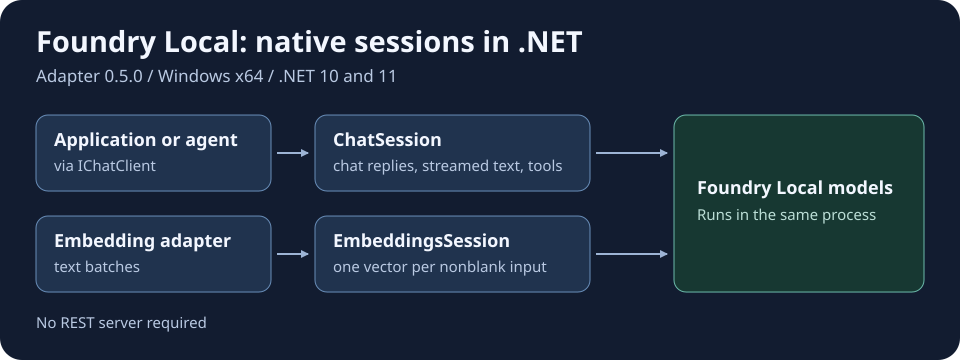

# Foundry Local 0.5.0: native sessions behind your .NET agent

`ElBruno.MAF.FoundryLocal.Adapter` 0.5.0 moves local chat, streaming, and embeddings to native Foundry Local SDK sessions. If your app already uses `IChatClient`, keep your agent code. The adapter now runs inference in-process through `ChatSession` instead of the deprecated OpenAI-compatible client, without starting a REST server.



Install on Windows x64 with .NET 10 or .NET 11:

```shell
dotnet add package ElBruno.MAF.FoundryLocal.Adapter --version 0.5.0
```

## Before and after: keep the interface, trade the plumbing

Before, callers using the low-level lifecycle API called the legacy SDK client directly:

```csharp
var legacy = await lifecycle.GetChatClientAsync();
var result = await legacy.CompleteChatAsync(FoundryLocalMessageMapper.Map(messages));
Console.WriteLine(FoundryLocalResponseMapper.Map(result).Text);
```

Now, resolve `IChatClient` from the [README's DI setup](../README.md#quick-start-foundry-local-as-ichatclient) and let the adapter manage native session lifetime. The following snippets reuse `chatClient` from that setup.

```csharp
using Microsoft.Extensions.AI;

ChatMessage[] messages = [new(ChatRole.User, "Explain local inference in one sentence.")];
var options = new ChatOptions { MaxOutputTokens = 80 };

var response = await chatClient.GetResponseAsync(messages, options);
Console.WriteLine(response.Text);

await foreach (var update in chatClient.GetStreamingResponseAsync(messages, options))
    Console.Write(update.Text);
```

The same client can back a Microsoft Agent Framework agent. Add the `Microsoft.Agents.AI` package if it is not already referenced:

```csharp
var agent = new Microsoft.Agents.AI.ChatClientAgent(
    chatClient: chatClient, instructions: "Answer in one concise paragraph.");
Console.WriteLine(await agent.RunAsync("What stays on-device in this example?"));
```

## Batch embeddings on-device

For an embedding workload, configure `FoundryLocalOptions.ModelAlias` to `qwen3-embedding-0.6b` in that workload's app setup, and register `FoundryLocalEmbeddingAdapter` alongside the lifecycle service. Resolve `embeddingAdapter` from DI:

```csharp
var batch = await embeddingAdapter.TryGenerateEmbeddingsAsync(
    ["Foundry Local runs models on-device.", "Embeddings are useful for search."]);

if (batch.Success)
    Console.WriteLine($"{batch.Embeddings.Count} vectors, in input order.");
else
    Console.Error.WriteLine(batch.FailureReason);
```

The embedding adapter uses `EmbeddingsSession`; it does not initialize a chat client. Typed decision support, including the KEV compatibility path introduced in 0.4.0, is unchanged.

**Upgrade notes:** Use `ChatResponse.Usage` or terminal streaming `UsageContent` for native token counts, not `RawRepresentation`, which is unset. `RequireSpecific` fails explicitly, so use `RequireAny` only if any available function is acceptable. Custom stop sequences hide the matching text across chunks, but the SDK still finishes generating. Legacy accessors remain on SDK 2.4.1 for migration; see the [migration guide](adapter-packaging-and-migration.md) for details.
